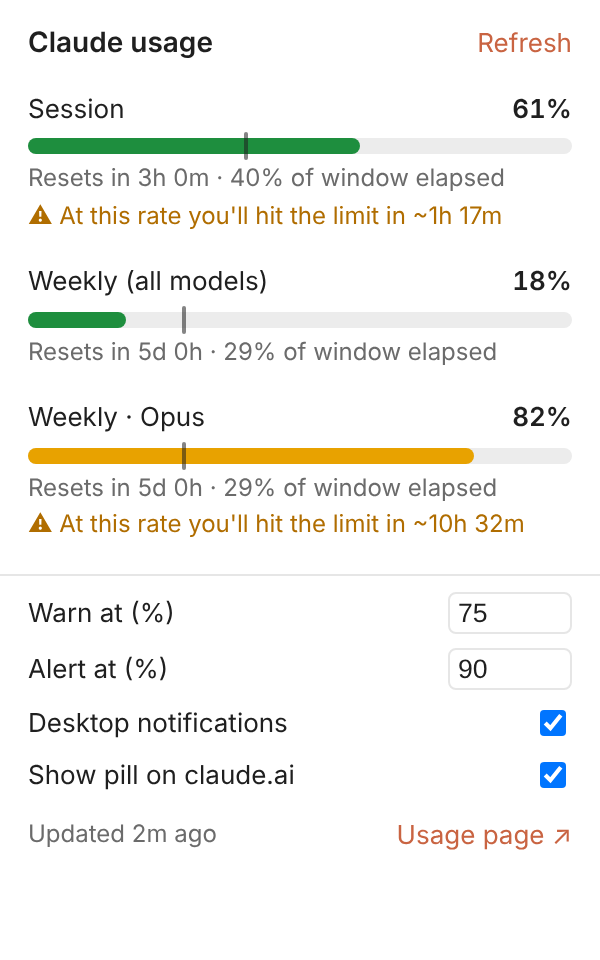
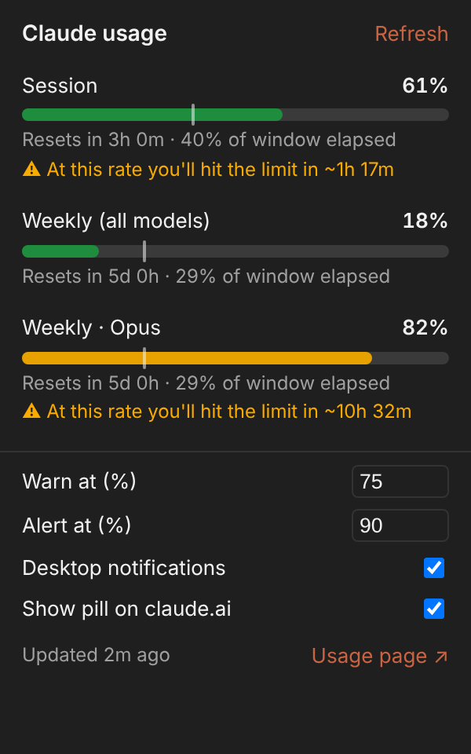
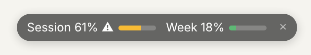

# Claude Usage Meter

[](https://github.com/Anandprasun/claude-usage-meter/actions/workflows/ci.yml)
[](LICENSE)

See how much of your Claude plan you've used, and get warned **before** you hit the limit, not after.

Four small, dependency-free tools. Pick the one(s) for where you use Claude:

| | Where it runs | What it shows |
|---|---|---|
| [**Mac menu bar**](#mac-menu-bar) | Your Mac's menu bar, whatever app you're in: Claude chat, Cowork, Code, a browser | Session and weekly % at a glance, dropdown with every limit, alerts |
| [**Chrome extension**](#chrome-extension) | claude.ai in Chrome, Edge, Brave, Arc | Toolbar badge, popup with every limit, on-page pill, desktop alerts |
| [**Claude plugin**](#claude-plugin-live-meter-inside-claude) | Inside Claude: Claude Code sessions in the desktop app, terminal or VS Code | Live usage under the prompt, a warning band, alerts, `/usage-meter` |
| [**Status line**](#claude-code-status-line) | Claude Code in your terminal | Model · context % · 5-hour bar · weekly % |

All four track the same limits as claude.ai → **Settings → Usage**: the **session** window (resets every 5 hours), the **weekly** window, and per-model weekly limits where your plan has them. Usage is shared across the Claude app, claude.ai and Claude Code, so each tool shows your total, wherever you used Claude.

**Getting the files**: every install below starts from a copy of this repository. Either clone it (`git clone https://github.com/Anandprasun/claude-usage-meter.git`) or click **Code → Download ZIP** on GitHub and unzip it somewhere you'll keep. The Claude plugin is the exception: it installs straight from GitHub with one command.

<p align="center">
  
  &nbsp;
  
</p>

## Why a pace warning

A percentage alone is misleading. 60% used with 20 minutes left until reset is fine; 60% used with 4 hours left means you'll run out halfway through the afternoon.

Both tools compare **% used** with **% of the window that has passed**. If your average rate so far would reach 100% before the reset, you get a ⚠ and an estimate of when. In the popup, the tick mark on each bar is the "even pace" point. If the fill is past the tick, you're ahead of a sustainable rate. More detail in [docs/how-it-works.md](docs/how-it-works.md).

---

## Mac menu bar

The one to use if you work in the Claude app: it sits in the menu bar at the top of the screen and is visible whatever you're doing.

```
◔ 42% · 18%          ← session · week; turns amber/red and gets a ⚠ when it matters
```

Click it for every limit with a bar, reset countdowns, and the pace warning. It refreshes every 2 minutes and notifies you at 75% and 90%, plus once if you're burning through a window too fast.

### Requirements

- macOS, with **Claude Code installed and signed in** with your Claude subscription. The meter reads your usage with that existing login, so there's nothing to configure. (Run `claude` in Terminal once if you've never signed in.)
- [SwiftBar](https://swiftbar.app), a free, open-source menu-bar app. The installer can add it for you via Homebrew.

### Install

```bash
git clone https://github.com/Anandprasun/claude-usage-meter.git
cd claude-usage-meter
sh macos-menubar/install.sh
```

The first time it runs, macOS asks whether SwiftBar may use **"Claude Code-credentials"** from your Keychain. Choose **Always Allow**. That's your existing Claude Code login; the meter only uses it to ask for your usage figures, and doesn't copy or store it.

Without git: download the repo as a ZIP from GitHub, unzip it, and run `sh macos-menubar/install.sh` from that folder. Or install SwiftBar yourself and copy `macos-menubar/claude-usage.2m.js` into SwiftBar's plugin folder.

**Update**: pull or re-download, and run the installer again. **Uninstall**: `sh macos-menubar/install.sh --uninstall`.

**Refresh rate**: the `2m` in the file name means every 2 minutes. Rename it to `claude-usage.1m.js` (or `5m`) in the plugin folder to change it.

If the menu bar shows **–**, click it: it says what's wrong (usually "Claude login expired", fixed by opening any Claude Code session, which renews the login). See [troubleshooting](docs/troubleshooting.md#mac-menu-bar).

---

## Chrome extension

### Install

1. [Get the files](#claude-usage-meter) and keep the folder: Chrome loads the extension from it, so don't delete it.
2. Open `chrome://extensions` (or `edge://extensions`, `brave://extensions`).
3. Turn on **Developer mode**.
4. Click **Load unpacked** and select the `extension` folder inside the repository.
5. Pin **Claude Usage Meter** from the puzzle-piece menu so the badge stays visible.
6. Open [claude.ai](https://claude.ai) while signed in. The badge fills in within a few seconds.

To update later, `git pull` (or download the ZIP again over the same folder), then click the reload icon on the extension's card in `chrome://extensions`.

**Safari**: Safari can load it for testing (Settings → Advanced → *Show features for web developers*, then Developer → **Add Temporary Extension…** and pick the `extension` folder), but Safari removes it when you quit, and desktop alerts don't work there. On a Mac, the [menu-bar meter](#mac-menu-bar) is the better choice.

### What you get

- **Badge**: your session %, green / amber / red. It turns amber early if you're ahead of pace, and switches to a weekly limit if that one crosses your alert level.
- **Popup**: every limit with a bar, reset countdown, pace tick and settings.
- **On-page pill** (bottom-right of claude.ai): session and week at a glance. Click it to open the usage page; × hides it (turn it back on from the popup).
- **Desktop notifications** at your warn level (default 75%) and alert level (default 90%), once per window, plus a one-time "burning fast" heads-up.

<p align="center"></p>

---

## Claude plugin: live meter inside Claude

A plugin that shows your usage inside Claude itself, live, with no unofficial endpoint involved. Claude sends it the same usage figures it uses for its own limit warnings, after each reply.

### Install

At the prompt of a Claude Code session:

```
/plugin install usage-meter --marketplace Anandprasun/claude-usage-meter
```

Answer `y` to add the marketplace, then choose where to install it (for yourself, or for one project).

From a shell:

```bash
claude plugin install usage-meter --marketplace Anandprasun/claude-usage-meter
```

In the desktop app, where `/plugin` doesn't run: click **+** next to the prompt box, then **Plugins**, **Add marketplace** with `Anandprasun/claude-usage-meter`, then **Add plugin**.

### What you get

- **Under the prompt**, always: `Session 61% ⚠ (resets 3h 00m) · Week 18%`. The ⚠ means you're on pace to hit the limit before it resets.
- **Above the prompt**, only when it matters (past 75%, or ahead of pace): a coloured bar for each limit with time to the limit and to the reset. **Hide** puts it away until things get worse.
- **Alerts** at 75% and 90% of each window, once per window, plus a desktop notification at 90%.
- **`/usage-meter`** prints the full breakdown.

Figures appear after the first reply in a session, and only on subscription plans (Pro, Max, Team, Enterprise); API-key usage has no plan limits to show.

### Where it doesn't work

Plugins like this run in Claude Code sessions (terminal, the desktop app's Code tab, VS Code). Chats and Cowork tasks in the Claude app don't load them, even when added there. For those, use the [Mac menu bar](#mac-menu-bar) meter.

---

## Claude Code status line

Requires Python 3 (standard library only). Works on macOS, Linux and Windows.

### Install

```bash
git clone https://github.com/Anandprasun/claude-usage-meter.git
cd claude-usage-meter
python3 claude-code/install.py
```

On Windows, use `python` instead of `python3`.

The installer copies the script to `~/.claude/usage-statusline.py` (or `$CLAUDE_CONFIG_DIR`), sets `statusLine` in `settings.json`, and keeps your other settings. It backs up `settings.json` first and tells you if it's replacing an existing status line. Restart Claude Code to see it.

```
Opus 5.5 · ctx 34% · 5h █████░░░ 61% ⚠ limit in ~1h 15m · resets 3h 00m · wk 18%
```

At the start of a session it shows `usage: n/a until first reply`, because Claude Code only receives the numbers after its first response.

### Options

Set these as environment variables before starting Claude Code:

| Variable | Default | Effect |
|---|---|---|
| `CLAUDE_USAGE_WARN` | `75` | % at which a value turns yellow |
| `CLAUDE_USAGE_ALERT` | `90` | % at which a value turns red |
| `NO_COLOR` | unset | Any value disables colours |

### Uninstall

```bash
python3 claude-code/install.py --uninstall
```

---

## Privacy

No data goes anywhere except Anthropic's own servers. The extension reads usage from claude.ai using your existing browser session and stores only the latest numbers and your settings. The menu-bar meter asks Anthropic's API for your usage with your existing Claude Code login, and stores only the latest numbers. The status line and the Claude plugin read only the figures Claude passes to them, and make no network requests. See [PRIVACY.md](PRIVACY.md).

## Caveats

- **The extension and the menu-bar meter rely on undocumented usage endpoints** (the extension uses the one behind claude.ai's Settings → Usage page; the menu bar the one Claude Code's own usage tools use). Anthropic can change them at any time. The parser handles both response formats seen so far, but if the badge stops updating, that's the most likely cause. The Usage page in Settings is always the source of truth. See [docs/troubleshooting.md](docs/troubleshooting.md).
- The status line and the Claude plugin use figures Claude itself supplies, which is the supported route. The plugin API is marked early access, so a future Claude update may need a plugin update.
- The pace projection assumes you continue at your average rate since the window opened. A burst of heavy work early in a window will look alarming until you slow down. That's intended.
- Team and Enterprise plans with different limit structures may show fewer windows.

## Documentation

- [How it works](docs/how-it-works.md): data sources, response formats, pace maths, polling
- [Troubleshooting](docs/troubleshooting.md)
- [Contributing](CONTRIBUTING.md)
- [Changelog](CHANGELOG.md)

## License

[MIT](LICENSE) © 2026 Prasun Anand

*This is an independent project and is not affiliated with, endorsed by, or supported by Anthropic. "Claude" is a trademark of Anthropic, PBC.*
